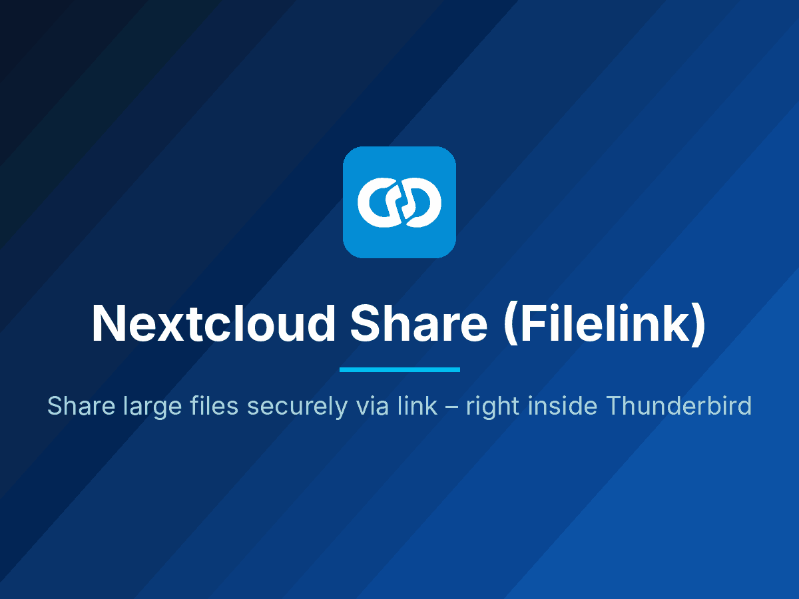
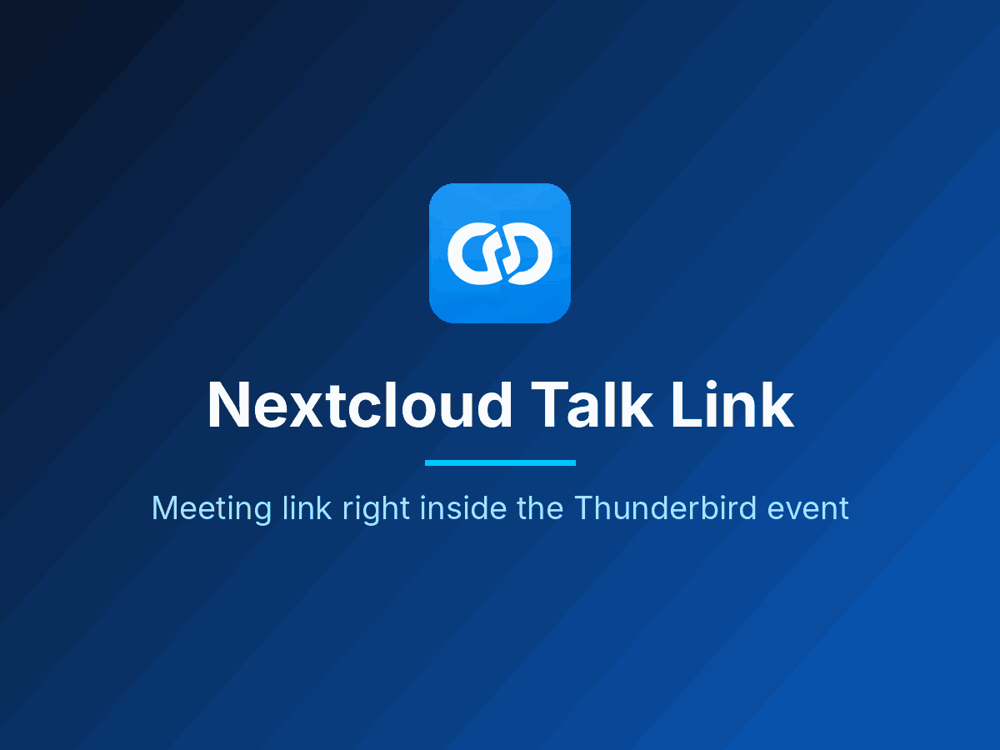
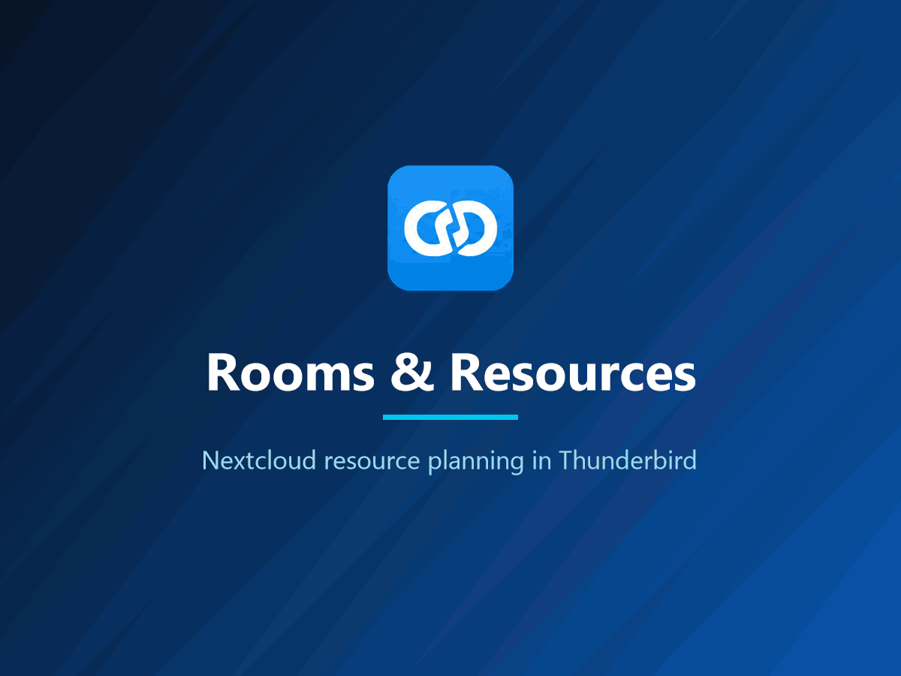

# NC Connector for Thunderbird

  <strong>Your Nextcloud, inside Thunderbird.</strong> 
  Share files, create Talk meetings, find rooms and resources, and keep your team’s signatures consistent, all from your mail and calendar.

  <a href="https://addons.thunderbird.net/thunderbird/addon/nc4tb/"><strong>Get the Thunderbird add-on</strong></a>
  &nbsp;·&nbsp;
  <a href="https://github.com/nc-connector/NC_Connector_for_Thunderbird/blob/main/docs/ADMIN.md#contents">Admin guide</a>
  &nbsp;·&nbsp;
  <a href="https://nc-connector.de/">Website</a>
  &nbsp;·&nbsp;
  <a href="https://github.com/nc-connector/NC_Connector_for_Thunderbird/blob/main/README.de.md">Deutsch</a>

For **Thunderbird on Windows, macOS, and Linux**, including new messages, replies, and forwards. Looking for Outlook? [Get the Outlook Classic add-in](https://github.com/nc-connector/NC_Connector_for_Outlook).

---

## See it in action

Four workflows, shown in Thunderbird. Expand a section to watch the demo.

<strong>Share files instead of sending large attachments</strong>

Combine files and folders from your computer and **My Nextcloud** in one share. Add a password, expiration date, and access permissions, then insert the link into your message. Existing Nextcloud files are copied into the share; the originals stay unchanged.

  

Attachment rules can offer sharing when a size limit is reached or handle attachments automatically. Choose a share-page link or a direct ZIP download. Compatible storage-provider add-ons can add more sources with the optional backend and a valid assigned seat.

*Local files, My Nextcloud, and attachment rules work with local settings, without NC Connector Backend.*

<strong>Create a Nextcloud Talk meeting from your calendar</strong>

Create a Talk room from a Thunderbird event and insert the meeting link. Configure password protection, a lobby, and moderation options without switching to the browser. Keep the Talk meeting in sync when the event changes.

  

*Works with local settings, without NC Connector Backend. Requires Nextcloud Talk.*

<strong>Keep your team's email signatures consistent</strong>

Design signature templates centrally in Nextcloud, use placeholders for user details, and apply the result to matching sender identities in Thunderbird. Signatures for unrelated accounts stay untouched.

  

*Requires the optional backend and a valid assigned seat. The free Community seat is sufficient.*

<strong>Find rooms and resources for your next meeting</strong>

Find rooms and equipment published through Nextcloud, including RoomVox and Calendar Resource Management. Filter by building, floor, capacity, equipment, and availability. Add one room and multiple resources to the event, or open a resource's day view to inspect free/busy times.

  

*Requires the backend and a valid assigned seat.*

Selection is not a booking confirmation. Use a **writable Nextcloud CalDAV calendar with server-side scheduling**, save and synchronize the event, then check the resource's response.

In that calendar's **Properties**, leave **Prefer client-side email scheduling** unchecked. After disabling it, **fully quit and restart Thunderbird** before creating a booking. Otherwise, the event may appear in Nextcloud without an actual resource booking. This applies to both native Nextcloud resources and resources from other apps.

## Optional backend. One full-featured seat included.

File sharing, **My Nextcloud**, Talk, and attachment rules work without the backend using local settings.

For centrally managed installations, add [NC Connector Backend](https://apps.nextcloud.com/apps/ncc_backend_4mc) to Nextcloud. It includes **one free Community seat**, assigned to one Nextcloud user. That seat unlocks the **same seat-based features as paid seats**; paid plans add seats for more users.

- Central settings, administrator locks, and delegated management
- Low-touch enterprise rollout with user-friendly sign-in
- Managed signatures, custom templates, and branding
- Room and resource picker with filters and availability checks
- Separate password delivery by email or one-time Nextcloud Secrets links; Secrets links also require the Secrets app
- Additional storage sources in Thunderbird, using compatible provider add-ons

Users in a centrally managed setup need the corresponding backend access and assigned seat.

[Install the free backend](https://apps.nextcloud.com/apps/ncc_backend_4mc) · [Plans and licensing](https://nc-connector.de/preise-lizenzierung/)

## Get started

1. Install NC Connector from [Thunderbird Add-ons](https://addons.thunderbird.net/thunderbird/addon/nc4tb/), or download an **XPI** from [Releases](https://github.com/nc-connector/NC_Connector_for_Thunderbird/releases) and choose **Install Add-on From File** in Thunderbird's Add-ons Manager.
2. Restart Thunderbird and open the NC Connector add-on settings.
3. Enter your Nextcloud URL and sign in with **Nextcloud Login** or an app password.
4. Test the connection and save your settings.

For managed deployment, follow the [enterprise rollout guide](https://github.com/nc-connector/NC_Connector_for_Thunderbird/blob/main/docs/ADMIN.md#enterprise-rollout).

### What you need

- **Thunderbird 140 or newer**, within the compatibility range listed for the selected add-on release
- **Windows, macOS, or Linux**
- **Nextcloud 32 or newer** over HTTPS, with Files Sharing enabled, permission to create public links, and sufficient storage
- **Nextcloud Talk** for online meetings
- A **writable Nextcloud CalDAV calendar with server-side scheduling** when booking rooms and resources

### Add more storage sources

With a valid assigned seat, compatible **VFS provider add-ons** can make other storage services available in the sharing wizard. Install the provider separately and grant the required access in NC Connector's **VFS** settings. Your configured Nextcloud remains available as **My Nextcloud** without an external provider.

[VFS Provider for Google Drive](https://github.com/nc-connector/vfs-provider-googledrive) · [Provider setup and permissions](https://github.com/nc-connector/NC_Connector_for_Thunderbird/blob/main/docs/ADMIN.md#vfs-sources-and-provider-access)

## Documentation

- [Admin guide](https://github.com/nc-connector/NC_Connector_for_Thunderbird/blob/main/docs/ADMIN.md#contents): setup, rollout, policies, updates, and troubleshooting
- [Development guide](https://github.com/nc-connector/NC_Connector_for_Thunderbird/blob/main/docs/DEVELOPMENT.md): build, tests, and architecture
- [Changelog](https://github.com/nc-connector/NC_Connector_for_Thunderbird/blob/main/CHANGELOG.md) · [Supported languages](https://github.com/nc-connector/NC_Connector_for_Thunderbird/blob/main/Translations.md) · [Screenshots](https://github.com/nc-connector/NC_Connector_for_Thunderbird/tree/main/screenshots)
- [License](https://github.com/nc-connector/NC_Connector_for_Thunderbird/blob/main/LICENSE.txt) · [Third-party components](https://github.com/nc-connector/NC_Connector_for_Thunderbird/blob/main/VENDOR.md)

## Open source, with clear data paths

File sharing and Talk use your own Nextcloud. Connected storage providers access the services you choose; file contents are not relayed through an NC Connector-hosted service.

The daily update check also provides an anonymous count of active users. Backend license checks are separate from file transfers.

[Trust and transparency](https://nc-connector.de/vertrauen-transparenz/) · [Public roadmap](https://github.com/orgs/nc-connector/projects/1)

## Help and feedback

Found a bug or have a feature request? [Open an issue](https://github.com/nc-connector/NC_Connector_for_Thunderbird/issues). Include your Thunderbird, add-on, and Nextcloud versions, plus steps to reproduce. Remove credentials and personal information from logs and screenshots.

For rollout questions, [get in touch](https://nc-connector.de/kontakt/). If NC Connector helps you, a GitHub star or [Thunderbird add-on review](https://addons.thunderbird.net/thunderbird/addon/nc4tb/) helps others find it.
